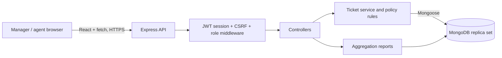
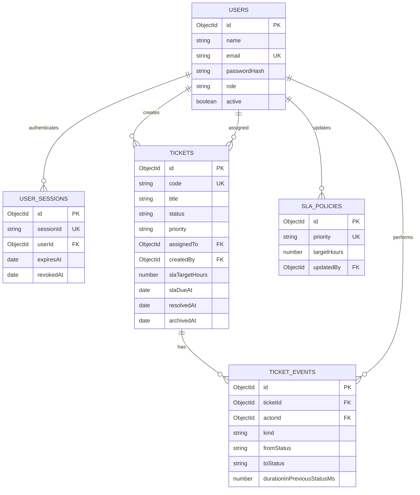
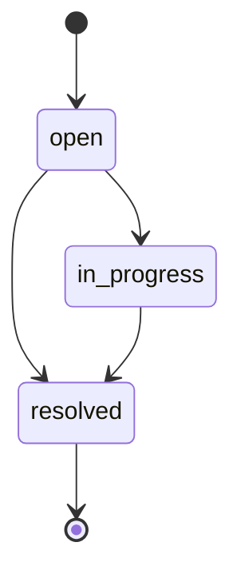
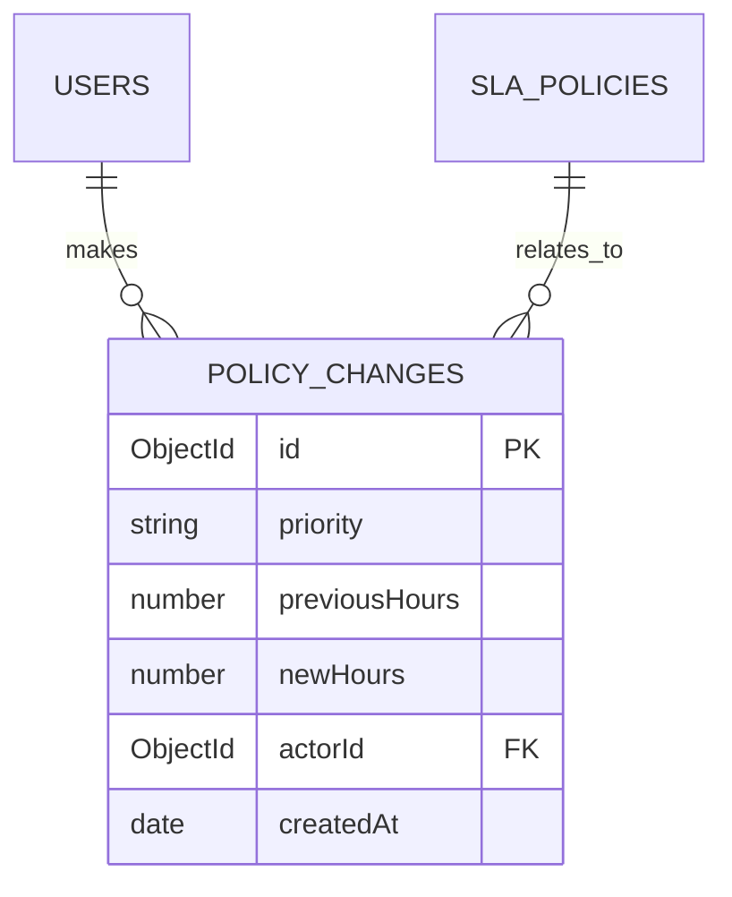

# System design — SLAWatch MERN

## Context and architecture

**MERN only:** React frontend, Node + Express API, MongoDB via Mongoose. HTTP API is a JSON REST-style interface. No independent analytics or AI backend.

## Database ER diagram

## Data flow (DFD level 0)

Manager/agent submits ticket or stage change → Express checks auth, role, CSRF and validates body → service executes business rules → MongoDB transaction writes ticket + ticketEvent → JSON response → React updates page. Analytics queries read stored ticket and event records and return grouped metrics without modifying records.

## API contracts

All successful responses are JSON. Failures use `{ "message": "..." }` and validation failures may add `errors[]`. JWT is stored in a secure-configured HttpOnly cookie, not localStorage. Every protected request checks its `jti` against a non-revoked `userSessions` record; logout revokes that record. Mutating protected routes require `X-CSRF-Token` from `/auth/login` or `/auth/me`.

| Verb | Route | Permission | Action |
|---|---|---|---|
| POST | `/api/auth/login` | Public; throttled | Login, cookie + CSRF token |
| GET | `/api/auth/me` | Authenticated | Current user + CSRF token |
| POST | `/api/auth/logout` | Authenticated | Revoke server-side session and clear cookie |
| GET | `/api/users` | Manager | List active agents |
| POST | `/api/users` | Manager | Create agent account |
| GET | `/api/tickets` | Authenticated | Active, filtered paginated list, scoped; `?archived=1` lists archives for managers only |
| POST | `/api/tickets` | Authenticated | Create and log ticket |
| GET | `/api/tickets/:id` | Manager or current assignee | Ticket plus audit history; archived records are manager read-only |
| PATCH | `/api/tickets/:id` | Manager (edit) / assignee (status only) | Edit + audit history |
| POST | `/api/tickets/:id/archive` | Manager | Soft-archive resolved ticket |
| GET | `/api/metrics/overview` | Authenticated | KPI aggregation + attention queue |
| GET | `/api/metrics/analytics` | Authenticated | Grouped trends, team and stage reports |
| GET | `/api/policies` | Authenticated | Read priority targets |
| PATCH | `/api/policies/:priority` | Manager | Change default target for future tickets |
| GET | `/health` | Public | Dependency health (503 if MongoDB unavailable) |

**Ticket listing query:** `?status=open&priority=high&category=network&q=vpn&page=1` (page size 15, bounded search). Object IDs are validated before use.

## Status state machine

Resolved tickets are immutable; manager may archive after resolution. Archiving does not delete MongoDB history. Managers can edit non-status fields while ticket is active; agents are restricted to status transitions on their own tickets.

## Ticket transition transaction

1. Start a MongoDB client session/transaction.
2. Read ticket and verify it exists, isn't archived and belongs to actor (unless manager).
3. Validate allowed status change and any new assignee.
4. Atomically condition update on `_id` + `__v`; increment `__v` to detect stale updates.
5. Append a `ticketEvents` record with actor, type and previous-stage time.
6. Commit; on error, rollback both changes.

**Indexes:** unique `users.email`, unique `userSessions.sessionId`, TTL `userSessions.expiresAt`, unique `tickets.code`, compound ticket indexes `{assignedTo,status,createdAt}`, `{status,slaDueAt}`, `{priority,createdAt}`, `{category,createdAt}` and `ticketEvents.{ticketId,createdAt}`. Use MongoDB Compass to show these indexes during evaluation.

## Analytics implementation

- **Overview:** aggregation `$match` + `$group` with conditional `$sum`/`$avg` and date arithmetic.
- **Reports:** `$dateToString`/`$group` for monthly trend; `$group` for category and priority; `$lookup` into users for team workload; stage-time aggregation from ticket events.
- **Role scoping:** manager sees global metrics; agent aggregation first matches `assignedTo = current user` and stage report joins ticket to ensure row-level authorization.
- **SLA policy:** stored per priority. On creation, copy target hours and computed due time into ticket; changing the policy later does not rewrite history.

## Deployment

Use a supported HTTPS frontend + Node host + MongoDB Atlas replica-set deployment. Set explicit `CLIENT_ORIGIN`, real `JWT_SECRET`, `NODE_ENV=production`, HTTPS/TLS, and host-only cookies if possible. Reverse proxy or configure the backend to serve the frontend from the same origin to simplify cookie/CSRF behavior. For different domains, carefully configure cookie `SameSite` and CSRF while retaining strict origin restrictions.

## Single-origin application hosting (v1.2)

**Development:** Browser → Vite `localhost:5173` → proxy `/api` → Express `localhost:5000` → MongoDB. The browser sees a single origin.

**Production:** Browser HTTPS → Node/Express → static `client/dist` for React routes or `/api` for JSON routes → MongoDB Atlas. The SPA HTML fallback never intercepts unknown `/api` endpoints. Server origin validation is configured with `CLIENT_ORIGIN=https://actual-domain`. This approach removes cross-site cookie configuration as a separate deployment dependency.

## Reporting design (v1.3)

- `GET /api/metrics/overview` returns six UTC creation-month buckets (`month`, `opened`, `resolved`) in addition to existing KPI counts and attention items.
- `GET /api/metrics/analytics?months=3|6|12` validates period values and uses a single authenticated **creation-month cohort** of tickets; archived records are excluded.
- MongoDB aggregation produces category and priority distribution, open backlog aging, five-way SLA outcome counts, resolution compliance by priority, stage transition duration and manager-scoped employee workloads.
- Agent-scope queries filter by the authenticated `assignedTo` user, including the joined ticket filter in stage events. Manager-only workload aggregations are not executed for agents.
- Calendar months use UTC, including the current month; missing months become zero-count entries.
- The “resolved” monthly series represents tickets *opened in that month that are resolved today*, **not** tickets whose `resolvedAt` happened in that month.
- The report assumes 24/7 elapsed-hour SLAs; stage metrics exclude currently in-progress stages.

## v1.4 corporate-style extension

The `POLICY_CHANGES` conceptual relationship is by `priority` (not an ObjectId foreign key). The policy and log are written in the **same MongoDB transaction**. Historical tickets retain their original SLA snapshot.

New API contracts: `GET /api/policies/history` (manager only, latest 30), `GET /api/metrics/analytics.csv?months=3|6|12` (authenticated, role-filtered), `/health/live` (process), `/health/ready` (MongoDB dependency). Analytics JSON and CSV both use `buildAnalyticsReport()` to avoid contradictory metrics. `X-Request-ID` supports basic support diagnostics; request logs omit bodies and query strings.

## v1.5 session lifecycle

1. Successful login creates a random `jti` and an eight-hour `userSessions` document before issuing the HttpOnly JWT cookie.
2. `requireAuth` verifies the JWT signature/issuer/algorithm, loads the active user and loads the matching session document. A revoked, missing or expired session is rejected.
3. CSRF tokens remain HMAC-derived from the session `jti`; the token is never stored in localStorage.
4. Logout updates `revokedAt` and clears the cookie. The session's TTL index eventually removes expired records; access control does not depend on TTL monitor timing.
5. `userSessions` is a sixth collection alongside `users`, `tickets`, `ticketEvents`, `slaPolicies` and `policyChanges`.
